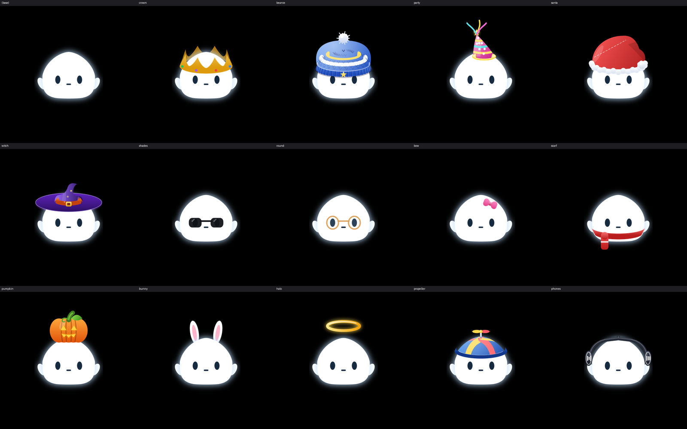

# Catálogo de accesorios y componentes de Miku

> Fuente: `miku_v7.html` (motor canvas procedural) y `Miku · Catálogo de diseño.html`. Todos los SVG usan `viewBox="0 0 128 128"`, sólo etiquetas nativas (`path`, `ellipse`, `defs`, `filter`, `linearGradient`, `radialGradient`, `clipPath`, `g`), sin scripts ni referencias externas.
> Pose capturada: **idle neutro** (yaw 0, pitch 0, `t = 0`), **sin partículas animadas** (chispas, confeti, murciélagos, copos, brasas): el motor del rig las dibuja en vivo.



## 1. Convención de montaje

```
posición_SVG_en_pantalla = posición_anchor_del_slot_en_pantalla − pivote_SVG        (px @ 128, × k de escena)
```

- **Marco del avatar**: 128×128, raíz `root = [64, 109]`, `head_top = [64, 22]`, `eyes_center = [64, 73.79]`, `mouth_center = [64, 82.34]`.
- Los SVG de gorros están **pre-registrados** con el mismo escalado del cuerpo (1 unidad = 1 unidad). Como casi todos sobresalen por encima de `y = 0`, cada archivo se desplazó `shift_y` px hacia abajo para no recortarse; el **pivote** (columna 6) refleja ese desplazamiento. Si colocas la esquina superior izquierda del SVG en `(0, −shift_y)` del marco del avatar, encaja sin ajustes.
- **Offset recomendado** = *Origen SVG vs anchor* (col. 7): esquina sup-izq del SVG relativa al anchor del slot. **Ajuste fino** = `(0, 0)` para todos; sólo úsalo para variantes de skin.
- Capa **trasera** = se dibuja *debajo* del cuerpo (z=10); **frontal** = encima de cara (z=70).
- Los accesorios del slot `head` y `neck` siguen la inercia (`follow_spring = true`, resorte `accessory_follow`); los del slot `face` viajan rígidos con los ojos.

## 2. Accesorios

| ID | Nombre | Archivo SVG (`miku/assets/avatar/accessories/`) | Capa | Slot → anchor | Pivote en SVG | Offset vs anchor | Posición SVG en marco (x, y) | Tamaño px |
|---|---|---|---|---|---|---|---|---|
| `beanie` | Gorro | `beanie.svg` | frontal | `head` → `head_top` `[64, 22]` | `[64, 42]` | `(-64, -42)` | `(0, -20)` | 106.5×87.5 |
| `crown` | Corona | `crown.svg` + `crown_back.svg` | frontal + trasera | `head` → `head_top` `[64, 22]` | `[64, 22]` | `(-64, -22)` | `(0, 0)` | 99×52 |
| `party` | Fiesta | `party.svg` | frontal | `head` → `head_top` `[64, 22]` | `[64, 64]` | `(-64, -64)` | `(0, -42)` | 56×76.5 |
| `santa` | Santa | `santa.svg` | frontal | `head` → `head_top` `[64, 22]` | `[64, 34]` | `(-64, -34)` | `(0, -12)` | 110×73.5 |
| `witch` | Bruja | `witch.svg` + `witch_back.svg` | frontal + trasera | `head` → `head_top` `[64, 22]` | `[64, 26]` | `(-64, -26)` | `(0, -4)` | 139×63 · ×0.9 |
| `pumpkin` | Calabaza | `pumpkin.svg` | frontal | `head` → `head_top` `[64, 22]` | `[64, 54]` | `(-64, -54)` | `(0, -32)` | 71×60 |
| `bunny` | Orejas de conejo | `bunny.svg` | trasera | `head` → `head_top` `[64, 22]` | `[64, 36]` | `(-64, -36)` | `(0, -14)` | 62×45 |
| `halo` | Aureola | `halo.svg` | frontal | `head` → `head_top` `[64, 22]` | `[64, 51]` | `(-64, -51)` | `(0, -29)` | 75×33.5 |
| `propeller` | Gorra de hélice | `propeller.svg` | frontal | `head` → `head_top` `[64, 22]` | `[64, 22]` | `(-64, -22)` | `(0, 0)` | 99×54 |
| `phones` | Audífonos | `phones.svg` | frontal | `head` → `head_top` `[64, 22]` | `[64, 22]` | `(-64, -22)` | `(0, 0)` | 125×56.5 |
| `bow` | Moño | `bow.svg` | frontal | `head` → `head_top` `[64, 22]` | `[64, 22]` | `(-64, -22)` | `(0, 0)` | 27×20 |
| `shades` | Gafas de sol | `shades.svg` | frontal | `face` → `eyes_center` `[64, 73.79]` | `[64, 73.79]` | `(-64, -73.79)` | `(0, 0)` | 65×18.5 |
| `round` | Gafas | `round.svg` | frontal | `face` → `eyes_center` `[64, 73.79]` | `[64, 73.79]` | `(-64, -73.79)` | `(0, 0)` | 65×26.5 |
| `scarf` | Bufanda | `scarf.svg` | frontal | `neck` → `neck` `[64, 99.77]` | `[64, 99.77]` | `(-64, -99.77)` | `(0, 0)` | 100×41 |

Notas por accesorio:

- **witch** y **phones** son más anchos que el marco; `witch` se escaló ×0.9 (alrededor del pivote) para que el ala quepa en 128 px. `phones` conserva su escala original.
- **bow** se monta en el lado superior derecho de la cabeza (ya posicionado en coordenadas del cuerpo; no requiere offset).
- **bunny** es *sólo trasero*: las orejas asoman por detrás de la cabeza.
- **crown** y **witch** tienen parte trasera (`*_back.svg`) y frontal.
- **scarf** se monta en el slot `neck` (`[64, 99.77]`), bajo la cara.
- **halo** reserva 12 px de margen superior para su resplandor (`feGaussianBlur`).

## 3. Componentes base del muñeco

| Componente | Archivo | z | Anclaje / pivote | Notas |
|---|---|---|---|---|
| Cuerpo + glow | `avatar/body.svg` | 30 | `root` [64, 109] | Superelipse (exp. 1.18 arriba / 0.60 abajo), `#FFFFFF`, glow `#BDDEFF` α .6 σ 5.5 (filtro `#glow`, id `glow-color` para teñir por estado) |
| Orejitas laterales | `avatar/ears.svg` | 20 | `left_ear` [14, 81] · `right_ear` [114, 81] | Elipses 13×24 rotadas ±0.5 rad; ids `ear_l`, `ear_r`. En tu código son `hand()` |
| Ojos abiertos | `avatar/expressions/eyes_open.svg` | 50 | `eyes_center` [64, 73.79] | Elipses 5.2×7.8, `#172B40` |
| Ojos cerrados | `avatar/expressions/eyes_blink.svg` | 50 | `eyes_center` | Escala Y mínima del parpadeo (×0.08) |
| Boca reposo | `avatar/expressions/mouth_idle.svg` | 60 | `mouth_center` [64, 82.34] | Trazo 6 px, ancho 2.6, cap redondo |
| Boca hablando | `avatar/expressions/mouth_talk.svg` | 60 | `mouth_center` | Fotograma medio (ry=3.0, lengua `#FF9DB8`); animar ry 0.8–4.8 |

## 4. Discrepancias entre el brief y el código (a revisar)

1. **Orejitas**: el muñeco base no tiene orejas dibujadas; lo que se ve a los lados son los `hand()` (brazos). Se exportaron como `ears.svg`. Las **orejas de conejo** son el accesorio `bunny`.
2. **Degradado de las orejitas**: son blanco plano; el degradado percibido es el glow. Las coletas teal (`#62E8DE → #25B1AB`) existen en `tails()` pero **nunca se llaman**, así que no se exportaron (además miden 160 px de ancho).
3. **Escalas**: idle ≈ 33 px (k = .34 ✔ 32 px del brief). **Hover 56 px no existe** en v7: `hover_open` abre la escena `overview` (k = .72 ≈ 71 px). El 56 px quedó en los tokens como valor del brief.
4. **Inercia de accesorios**: v7 no la implementa (los gorros se dibujan rígidos, sólo oscilan pompones por seno). El resorte `accessory_follow` (k 90, c 8) es una **propuesta** coherente con los demás.

## 5. Tokens de UI relacionados

Ver `miku/assets/design-tokens.json` → `ui`, `motion`, `island`: monocromo sobre negro, único acento verde `#30D158`, rojo sólo para error `#FF453A`, resorte para lo físico (`cubic-bezier(.3,1.35,.5,1)` en la isla), ease óptico 150–300 ms, presionar = escala .93–.97, entrada con blur 12 px, salida a la mitad de duración.
